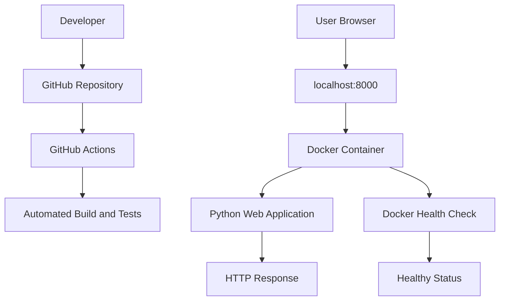

# CloudOps Architecture Diagram

## Explanation

- **GitHub:** Stores project source code and documentation.
- **GitHub Actions:** Automates the configured build and test workflow.
- **Docker:** Runs the Python application in a container.
- **Python Web Application:** Responds to browser requests on port 8000.
- **Health Check:** Verifies that the application is responding.

## Deployment Status

The application was tested locally using Docker. The container health status was reported as `healthy`, and the application returned HTTP 200 OK. Cloud deployment and Kubernetes orchestration remain future improvements.
